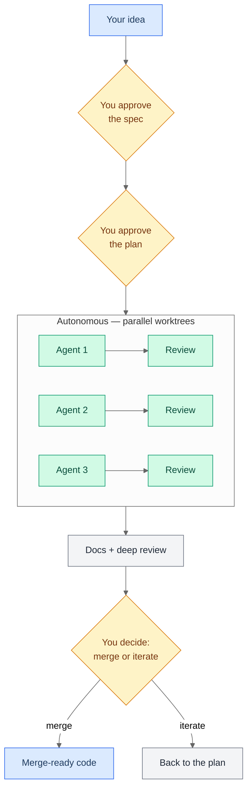
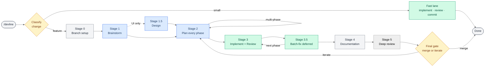
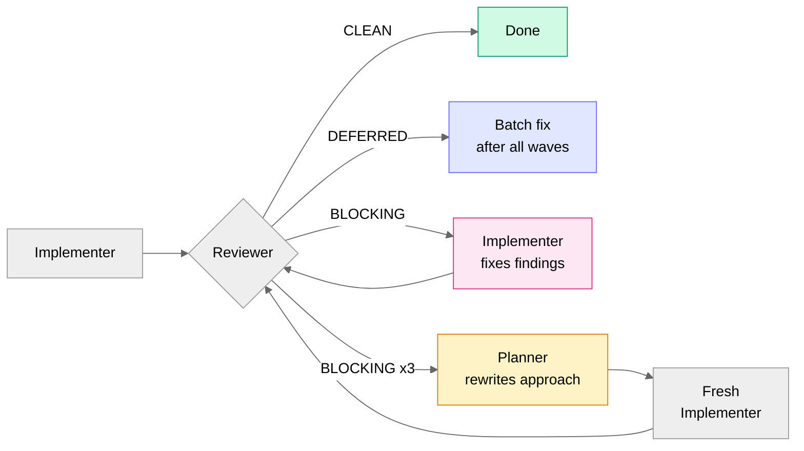
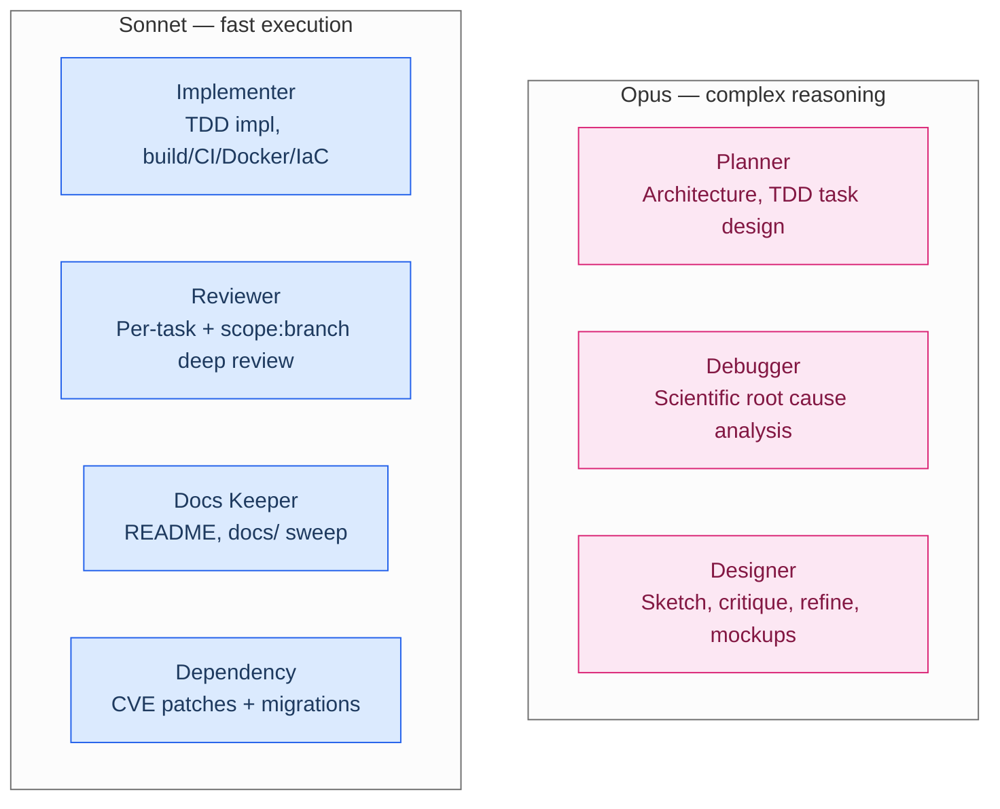
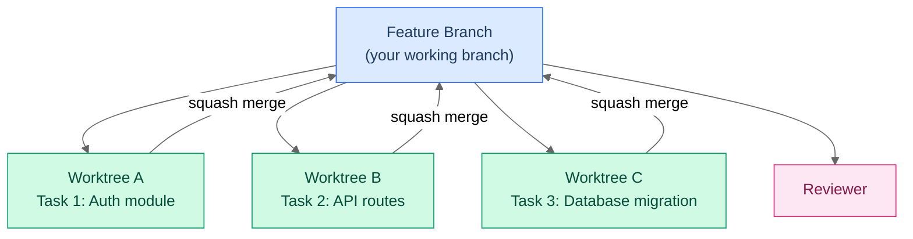

# devline

A Claude Code plugin that turns a rough idea into merge-ready code. It brainstorms scope, plans a TDD architecture, implements tasks in parallel worktrees, reviews every line, updates your docs, and runs a final security audit. You approve twice (after brainstorm, after plan) and get working code back.



---

## Install

### Quick install

```bash
curl -fsSL https://raw.githubusercontent.com/Conava/claude-devline/main/install.sh | bash
```

Installs Claude Code (if missing), the devline plugin, and the recommended companions (RTK, Ponytail). Works on **Linux** (apt/pacman/dnf/zypper/apk), **macOS** (Homebrew), and **Windows via WSL or Git Bash** — it prompts before installing any missing underlying tool. Review the script first if you like. Flags: `--minimal` (devline only), `--skip-rtk`/`--skip-ponytail`, `--yes` (non-interactive). Example: `curl -fsSL https://raw.githubusercontent.com/Conava/claude-devline/main/install.sh | bash -s -- --minimal`.

### From the marketplace

```bash
claude plugin marketplace add Conava/claude-devline
claude plugin install devline@devline
```

### From source

```bash
git clone https://github.com/Conava/claude-devline.git
claude --plugin-dir ./claude-devline
```

Then run `/devline:setup` in your project. It creates a `CLAUDE.md` (project context for agents) and, if you want them, the [config files](#configuration) through an interactive walkthrough.

### Requirements

- Claude Code with plugin support
- `jq`, `git`, [`gh`](https://cli.github.com/)
- For design captures (optional): Node.js and `playwright-core` with Chromium in `~/.cache/devline/capture` (`npm i --prefix ~/.cache/devline/capture playwright-core && node ~/.cache/devline/capture/node_modules/playwright-core/cli.js install chromium`, about 150 MB). `/devline:design` asks before installing it; without it the critic judges from the HTML only.
- Recommended: `export CLAUDE_CODE_MAX_OUTPUT_TOKENS=128000` in your shell profile. The designer and other agents produce large outputs (HTML prototypes, design systems). The default 32K limit will cut them off.

### Permissions

Run devline in Claude Code's **auto-accept mode** (toggle with Shift+Tab). The pipeline runs many parallel agents reading files, writing code, and running builds — auto-accept keeps it from stalling on a prompt per tool call, while still surfacing anything the security hooks flag.

Safety comes from hooks, not permission dialogs. The plugin ships ~19 focused security rules that block irreversible or destructive operations before they execute -- force pushes, deleting system paths, the home directory or keys, reading or changing secrets, publishing commands, destructive database operations. See [Security Hooks](#security-hooks).

For zero prompts on long unattended runs you can also add `--dangerously-skip-permissions`; the security hooks still apply.

---

## Recommended companions

Optional, but they make devline leaner and more capable — `/devline:setup` offers to install both, and the [quick installer](#quick-install) sets up both automatically.

- **[RTK](https://github.com/rtk-ai/rtk)** — a CLI proxy that filters command-output noise for 60-90% token savings. devline runs many parallel agents issuing Bash commands, so it compounds.
  ```bash
  curl -fsSL https://raw.githubusercontent.com/rtk-ai/rtk/refs/heads/master/install.sh | sh
  rtk init -g
  ```
- **[Ponytail](https://github.com/DietrichGebert/ponytail)** — a separate Claude Code plugin that keeps generated code minimal (YAGNI, stdlib-first, shortest working diff). It composes with devline: devline enforces the process, ponytail keeps the code it produces lean.
  ```
  /plugin marketplace add DietrichGebert/ponytail
  /plugin install ponytail@ponytail
  ```

---

## Commands

| Command | What it does |
|---------|-------------|
| `/devline <idea>` | Full pipeline -- brainstorm through deep review |
| `/devline:brainstorm <idea>` | Refine an idea into a feature spec |
| `/devline:plan <spec>` | Create a TDD implementation plan |
| `/devline:implement` | Implement tasks from an existing plan |
| `/devline:quick <task>` | Fast lane -- implement, review, and commit a small change |
| `/devline:git [commit\|push\|pr]` | Commit with a Conventional Commit message, push, or write a PR body to an editable file and open the PR |
| `/devline:review` | Code review of recent changes |
| `/devline:debug <error>` | Systematic root cause analysis |
| `/devline:deep-review` | Final merge-readiness audit (runs the reviewer at `scope: branch`) |
| `/devline:deps [--migrate] <CVEs \| package>` | Patch CVEs, or migrate a major version with `--migrate` |
| `/devline:design [mockup] <what>` | Explore new designs (sketch, critique, refine) or build an interactive mockup |
| `/devline:verify-setup [focus]` | Set up how this project's changes are verified: sandboxed real-app run, log scan, budgets |
| `/writing` | Clean AI slop and catch mistakes in your writing (write yourself, polish here); strict citation enforcement for scientific text |
| `/brand` | Brand voice, visual identity, messaging |
| `/graphic-design` | Logos, icons, banners, slides, corporate identity |

`/devline:verify-setup` inspects the project, proposes a verification setup and writes only what you pick, mainly the native `.claude/skills/verify/SKILL.md` that Claude Code 2.1.286+ prompts Claude to run before commits (a prompt, not an enforced hook; docs-only and tests-only commits excepted). It runs the fast path once and leaves everything uncommitted.

---

## How the Pipeline Works

Stage 0 through Stage 5, plus a final gate. You approve twice — after brainstorm and after plan — then make the final merge-or-iterate call; the rest runs autonomously. Small changes take the fast lane straight to implement → review → commit.



<details>
<summary><strong>Stage 0: Branch Setup</strong> (automatic)</summary>

Reads the branching settings from your [config](#configuration). If you're on a protected branch (main, master, develop, release, production, staging), it creates a feature branch using your configured format (default: `feat/your-feature-name`). Sets up the `.devline/` working directory and, if git does not already ignore it, adds it to `.git/info/exclude` so no tracked file changes.

If a previous pipeline left artifacts behind, it detects them and asks whether to resume or start fresh.

</details>

<details>
<summary><strong>Stage 1: Brainstorm</strong> (interactive)</summary>

Focuses on what you're building and where it fits -- not implementation details. Asks 1-4 structured questions with selectable options (scope, behavior, platform, aesthetics), then writes `.devline/brainstorm.md` capturing scope, architecture impact, UI impact, and key decisions.

For larger features, the brainstorm detects natural phase boundaries and splits the work into sequential phases. Each phase gets its own plan later.

You approve the spec before anything else happens.

</details>

<details>
<summary><strong>Stage 1.5: Design</strong> (interactive, conditional)</summary>

Triggers only when the brainstorm identifies design-level UI work (new pages, components, a redesign). Runs the design skill's exploration loop: cheap sketches from deliberately different seeds, a fresh critic culls the weak ones, you pick from a gallery of screenshots, only your picks become full prototypes, and each is refined against rendered captures until a critic that didn't build it scores it 8+ on both wow and craft. If you already have a mockup (for example from `/devline:design mockup`), it becomes the design input instead.

When you approve a design, it is written down as `docs/design-system/MASTER.md`: tokens, components, rules, an acceptance checklist and an append-only Corrections log. Planner, implementer and reviewer treat it as binding: tokens only, no literal colours or sizes.

</details>

<details>
<summary><strong>Stage 2: Plan</strong> (interactive)</summary>

The planner reads the brainstorm and the design system (if any), traces execution paths through your codebase, and produces a TDD plan with:

- **Parallel tasks with file-based isolation.** Each task owns specific files. No merge conflicts between same-wave tasks.
- **Dependency graph.** Wave 1 tasks run in parallel. Wave 2 waits for Wave 1 to finish. And so on.
- **Feature-goal tests.** The final wave includes an E2E test that proves the feature works end-to-end.
- **Integration contracts.** Observer notifications, lifecycle hooks, state propagation between tasks.
- **Proactive improvements.** Code issues discovered during codebase analysis, presented as include/skip choices.

Writes `.devline/plan.md` (or `.devline/plan-phase-N.md` for multi-phase pipelines). You approve before implementation starts.

**Multi-phase pipelines:** When the brainstorm defines phases, all phase plans are created and approved before any code is written. This gives you full scope visibility upfront. Changing a plan is cheap. Changing implemented code costs a full pipeline cycle.

</details>

<details>
<summary><strong>Stage 3: Implement + Review</strong> (autonomous, parallel)</summary>

One agent per task, each in its own git worktree. Strict TDD cycle: write a failing test, make it pass, refactor.

After each task, a reviewer checks correctness, security, performance, and integration contract compliance. The review loop:



**Wave barriers are strict.** Every task in Wave N must be implemented, reviewed, and merged before any Wave N+1 task launches. No exceptions, no "this one looks ready."

**Agent health monitoring** tracks elapsed time from launch. Nudge at 20 minutes, investigate at 30, hard kill at 45. Stuck agents get replaced, not nursed.

**Deferred findings** (minor code quality issues) are collected across all tasks and batch-fixed by a single implementer after the last wave completes.

</details>

<details>
<summary><strong>Stage 4: Documentation</strong> (autonomous)</summary>

The docs-keeper reads the plan and `git diff`, then sweeps all documentation -- README, CLAUDE.md, everything in `docs/` -- for staleness. It finds what needs updating on its own. No list needed.

</details>

<details>
<summary><strong>Stage 5: Deep Review</strong> (autonomous, final gate)</summary>

Cross-cutting review that catches what per-task reviewers can't see:
- Cross-task integration failures
- Regressions in existing functionality
- Security issues that emerge when tasks combine
- Feature-goal verification (traces execution path end-to-end through actual code)
- Credential scanning, stale artifact detection, test quality audit

The deep review can't defer findings. Every issue must be fixed. The escalation ladder: implementer fixes -> debugger investigates root cause -> planner redesigns approach -> ask user for guidance.

Only a structured APPROVED verdict from the reviewer (`scope: branch`, running on Opus) moves the pipeline forward. Partial output, timeouts, or ambiguous responses trigger a relaunch.

</details>

---

## Agents

Seven specialized agents, each with a defined role and model assignment.



<details>
<summary><strong>Agent details</strong></summary>

| Agent | Model | What it does |
|-------|-------|-------------|
| **Planner** | Opus | Traces execution paths, maps blast radius, designs dependency-ordered tasks with test cases and acceptance criteria. Returns NEEDS_INPUT for ambiguous decisions instead of guessing. |
| **Implementer** | Sonnet | One task, one agent, strict TDD. Runs in a git worktree. Also handles build systems, CI/CD, Docker, and infrastructure-as-code tasks. Validates spec against actual codebase before writing code. Commits only specific files -- never `git add .` |
| **Reviewer** | Sonnet (Opus for `scope: branch`) | Per-task review (`scope: task`): correctness, spec compliance, integration contracts, security (OWASP + multi-tenant), performance, code quality, plan compliance, test assertion quality, stale artifacts, mandatory test run. As the final gate (`scope: branch`, Opus) it builds and tests first (any failure = HAS_FINDINGS), then runs the cross-task integration sweep, feature-goal trace, regression check, and branch-level architecture review. |
| **Debugger** | Opus | Six-phase scientific method: check known patterns, reproduce, gather evidence, hypothesize (2-3 ranked), test hypotheses, verify and prevent. Can operate standalone or as a pipeline planner for failed review loops. |
| **Designer** | Opus for build/refine/critique (`design_model`); Sonnet for seeds/sketch/cull (`sketch_model`) and mockups (`mockup_model`) | One design step per launch: seeds, sketch, cull, build, refine, critique, mockup. Builds self-contained HTML from real content; critiques only from rendered captures (stills, recordings, frame diffs, slop scan) of work it didn't build. |
| **Docs Keeper** | Sonnet | Proactive documentation sweep. Reads `git diff` and plan, scans ALL docs for staleness, completeness, and formatting issues. Checks internal links, code examples, and renamed references. |
| **Dependency** | Sonnet (Opus for migrations) | Both CVE/version patches and major-version migrations. Detects ecosystem (npm, Maven, Gradle, pip, cargo, etc.), checks if the package is affected, updates, verifies build/tests, commits. For migrations (opus, migration block on) it researches guides, runs ecosystem tools (OpenRewrite, Rector, codemods), and refactors breaking changes. |

</details>

---

## Architecture

How the pieces fit together.

```
claude-devline/
|-- .claude-plugin/          # Plugin metadata (name, version, author)
|   |-- plugin.json
|   +-- marketplace.json
|
|-- agents/                  # Agent definitions (one .md per agent)
|   |-- planner.md
|   |-- implementer.md       # also handles build/CI/Docker/IaC tasks
|   |-- reviewer.md          # per-task review + scope:branch deep review
|   |-- debugger.md
|   |-- designer.md          # design exploration + mockups
|   |-- docs-keeper.md
|   |-- dependency.md        # CVE patches + major-version migrations
|   +-- references/          # Shared agent templates
|       +-- plan-format.md
|
|-- skills/                  # User-invocable commands and knowledge bases
|   |-- devline/             # Main orchestrator (/devline)
|   |   |-- SKILL.md
|   |   +-- references/      # Implementation protocol, worktree protocol, agent health
|   |-- setup/               # /devline:setup
|   |-- git/                 # /devline:git (commit, push, PR body)
|   |-- find-docs/           # Context7 doc lookup (used by agents)
|   |-- design/              # /devline:design (references, capture + slop-scan scripts)
|   |-- writing/             # /writing (purpose-aware: AI-slop cleanup + scientific citation enforcement)
|   |-- kb-tdd-workflow/     # TDD methodology (injected into agents)
|   |-- kb-engineering/      # Testing, reliability, performance, security checklists + router, setup recipe, procbudget.py helper
|   |-- kb-m3e/              # Material 3 Expressive spec values + compliance checklist (design strict mode)
|   |-- verify-setup/        # /devline:verify-setup
|   +-- ...                  # More skills and knowledge bases
|
+-- hooks/                   # Security rules, compaction, agent logging
    |-- hooks.json
    +-- scripts/
        |-- validate-bash.sh       # ~19 bash command security rules
        |-- validate-write.sh      # Credential and secret detection
        |-- pre-compact.sh         # Steers the compaction summary
        |-- restore-state.sh       # Re-injects pipeline state after compaction
        +-- subagent-stop.sh       # Agent completion logging
```

<details>
<summary><strong>How agents get their knowledge</strong></summary>

Agents don't start from scratch. Knowledge bases (the `kb-*` skills) get injected into agents at launch:

| Knowledge Base | Injected Into | What It Provides |
|----------------|---------------|-----------------|
| `kb-tdd-workflow` | Implementer, Debugger | Test level selection (unit vs integration vs E2E), Red-Green-Refactor cycle, framework detection, what NOT to test |
| `kb-blast-radius` | Planner, Reviewer | Reverse dependency tracing -- "if I change file X, what breaks?" Grep-based import analysis across 12 languages |
| `kb-dependency-management` | Dependency | Ecosystem detection for 10+ package managers, version update mechanics, verification commands |
| `kb-engineering` | Implementer, Reviewer | A router that picks checklists by stack and change type (testing, reliability, performance, security, web, backend, Java, desktop, distributed), always-on rules, the verification-evidence format, and an opt-in process budget sampler |
| `kb-m3e` | Designer and critic in strict mode (passed as a path); any agent in an M3E project can load it | Material 3 Expressive token values (motion springs, shape, colour roles, type scale, components, layout, desktop input) and the strict-mode compliance checklist |
| `find-docs` | All agents | Context7 integration for live library documentation lookup |

</details>

---

## Worktree Isolation

Every implementer runs in its own git worktree. This is how parallel agents avoid stepping on each other.



Each worktree is a full copy of the repo at the current branch HEAD. Agents write code, run tests, and commit inside their worktree. When they're done, the orchestrator squash-merges their branch back -- one clean commit per task, linear history.

Merge conflicts between same-wave tasks shouldn't happen because the planner assigns non-overlapping file ownership. If one does occur, the orchestrator doesn't try to resolve it. It cleans up and relaunches the agent without isolation.

<details>
<summary><strong>Build isolation</strong></summary>

Worktree agents also isolate their build environments:

- **Gradle/Maven:** `--no-daemon` flag prevents daemon contention. `GRADLE_USER_HOME` is set to the worktree directory so parallel builds don't corrupt each other's caches.
- **File staging:** Agents stage specific files by name. Never `git add .` or `git add -A`, which would pull in caches, IDE files, or other agents' artifacts.
- **Test runs:** Only the task's own tests during TDD. Full suite runs once at the end.

</details>

---

## State Persistence and Recovery

Long pipelines survive context compaction. All mutable state lives on disk.

| File | Purpose |
|------|---------|
| `.devline/state.md` | Task progress, active agent count, launch timestamps (ISO 8601), phase tracking |
| `.devline/deferred-findings.md` | Minor review findings queued for batch fix |
| `.devline/agent-log.md` | Agent completion log (written by the SubagentStop hook) |
| `.devline/plan.md` | Implementation plan for single-phase pipelines |
| `.devline/plan-phase-N.md` | Per-phase plans for multi-phase pipelines |
| `.devline/fix-task-N.md` | Blocking findings for a specific task's fix cycle |
| `.devline/brainstorm.md` | Approved feature spec |
| `.devline/design/` | Design exploration: seeds, sketches, captures, critiques, finals, gallery (if UI) |

A **PreCompact hook** turns every compaction summary into a handoff, in any session: the goal and next step, every file, log location, URL and screenshot the user pointed to and why, the user's decisions and corrections, failed attempts and why they failed, and the working state. While a pipeline is active, a **SessionStart hook** (matcher `compact`) then re-injects `state.md`. The orchestrator picks up where it left off. Absolute timestamps in `state.md` let health monitoring compute correct elapsed times after recovery.

`.devline/` artifacts are cleaned up when the pipeline finishes. They're never committed -- a hook blocks staging anything under `.devline/`.

<details>
<summary><strong>Recovery protocol</strong></summary>

When the orchestrator loses context (compaction, new conversation, crash), it reconstructs state:

1. Read `.devline/state.md` -- check for `## END` integrity marker. Missing marker means the file was partially written.
2. For multi-phase pipelines, check which `.devline/plan-phase-*.md` files exist and cross-reference git log for completed tasks.
3. Read `.devline/deferred-findings.md` for collected review findings.
4. Cross-check `git log --oneline` for `task-N:` commits against state.md. If a task has a commit but state shows `building`, the crash happened after commit but before state update -- mark it done.
5. Check running agents via TaskList (stored agent IDs are stale after compaction).
6. Check for orphaned `.devline/fix-task-*.md` files -- each represents an interrupted fix cycle.
7. Read `.devline/agent-log.md` for agent completions that weren't processed before the crash.
8. Recompute elapsed times from absolute timestamps and resume health monitoring at the correct escalation level.

</details>

---

## Security Hooks

The plugin ships PreToolUse hooks that validate every Bash command, file write, and branch operation before execution.

<details>
<summary><strong>What's blocked (~28 rules)</strong></summary>

The hooks stop catastrophic actions and secret exposure, and ask before risky or outward-facing ones -- not workflow policy. (Protected-branch pushes, commit-message format, tags/releases, and squash-merge enforcement were removed on the scrub branch.)

Three tiers. **Deny** is for what is catastrophic or exposes secrets. **Ask** is for what may be fine but may not be, or acts in your name; you confirm it even in bypass mode. Everything else is **allowed**. An ask never masks a deny later in the same command.

| Tier | What |
|------|------|
| **Deny: system and home** | `rm` of `/`, `/home`, `~`, `/etc`, `/usr`, `/var`, `/boot`, `/bin`, `/lib`… or a glob that empties one of them; `--no-preserve-root`; `mkfs`/`fdisk`/`dd` to devices; `kill -9 1` |
| **Deny: secrets** | Reading, moving, overwriting or deleting private keys, `~/.gnupg`, cloud/kube/git/postgres credentials, `/etc/shadow`, `~/.password-store`, keyrings (Bash or Read/Edit); reading `.env*` (creating and appending is fine); tools that print stored secrets (`gh auth token`, `pass show`, `secret-tool lookup`, `kubectl get secret -o yaml`, cloud token printers); dumping the environment or printing secret variables; sending secrets to external URLs; changing user passwords; mounting credential dirs into a container; hardcoded keys, tokens and passwords in written files |
| **Ask** | Deletes inside system dirs, of `~/.config`/`~/.local`, of a whole top-level home folder or a whole git repository; bare force push (`--force-with-lease` passes); `git reset --hard`, `git clean -f`; package publishing and image push; `gh pr merge/close/reopen`, `gh issue close/delete/comment`; `DROP`/`TRUNCATE`/bulk `DELETE`; deleting container volumes; privileged containers and host mounts; system `systemctl`/`service` control (`--user` passes); recursive `chmod 777`; writing `authorized_keys`; `crontab -r`; external HTTP POST/PUT/DELETE/PATCH; piping `curl`/`wget` into a shell; running a script or compose stack whose contents contain any of the above |
| **Allowed** | Everything else, including deletes of temp files, documents, caches, project folders and anything outside git, ssh/scp to other machines (remote commands get the same rules, except service control) |

</details>

<details>
<summary><strong>Smart exemptions</strong></summary>

- **Test files** skip credential detection. Test code legitimately contains fake API keys and tokens. Detected by path patterns: `/test/`, `/tests/`, `/__tests__/`, `.test.`, `.spec.`, `/fixtures/`, `/testdata/`.
- **Common placeholder passwords** (`test`, `example`, `placeholder`, `changeme`, `dummy`, ...) are allowed, so examples and docs don't trip the secret scanner.
- **SSH keys** stay usable without being readable: `ls`/`stat`/`chmod` on `~/.ssh`, `ssh-keygen`, `ssh -i`, `git -c user.signingKey=...`, and `*.pub`/`config`/`known_hosts` reads all pass.
- **`.env` templates** (`.env.example`, `.sample`, `.template`, `.dist`) are readable; `cp .env.example .env` and `echo X >> .env` work.
- **Everyday Docker** is untouched: `build`, `run`, `exec`, `compose up`, `-p` publishing, named volumes, project-local mounts, and `:ro` mounts of things like `/etc/localtime`.

`bash hooks/scripts/test-hooks.sh` runs the 53-case check table behind these rules.

</details>

---

## Design

`/devline:design` has two modes, run by the designer agent one step per launch. Nobody scores their own work: every critique is a fresh launch that sees only captures.

| Mode | Use case |
|------|----------|
| **Exploration** (default) | New looks for a page, site or app. 10 cheap sketches (a finished first screen + a storyboard of the signature motion), a critic culls to 4-8, you pick 2-4, those become full prototypes and are refined until they score 8+. At least one sketch is an ambitious interactive or 3D piece. |
| **Mockup** (`/devline:design mockup <what>`) | One cheap, interactive HTML mockup of exactly the surface a change touches: a page, an app screen, a desktop widget, a dialog. Uses the project's tokens, fonts, icons and wording; a separate control section holds only the inputs you can't change inside the mock. Change requests edit it in place, with a feedback log so later rounds don't undo earlier decisions. |

**Material 3 Expressive strict mode** turns on when the project uses M3E (or you ask for it): every value comes from the spec, decisions only where the spec leaves room, and the critic fails anything off-spec. It needs the `kb-m3e` skill and stops if it's missing. Otherwise the default mode applies.

Captures (stills, scroll or scripted recordings, frame-change report, page errors) come from `skills/design/scripts/capture.mjs`, which needs `playwright-core` (see [Requirements](#requirements)). `slop-scan.mjs` flags common AI-look patterns. Third-party sources are listed in `skills/design/CREDITS.md`.

---

## Commits, Pushes and Pull Requests

`/devline:git` handles the final commit, push and PR at the end of a pipeline or fast lane, or whenever you ask. Each mode includes the one before it, and the default is `commit`.

- **`commit`** -- stages the files that belong to the change and writes a Conventional Commit.
- **`push`** -- commits anything pending, then pushes the current branch.
- **`pr`** -- commits, pushes, and writes the PR body to `.devline/pr-body.md`. It stops there so you can edit the file, and runs `gh pr create --body-file` only when you say to post.

Messages follow the `writing` skill. The body says why the change was needed and what it does at a level the code doesn't show, and never restates the diff. The PR body follows the repo's PR template when there is one. Otherwise it has a short `## Description` (what and why: intended effect, use case, issue), then the technical details (how it works, trade-offs, notable effects, closed issues), screenshots for UI changes, and a short `## Verification` only when it is needed.

The skill never pushes to a protected branch without asking and never force-pushes on its own. It uses `--force-with-lease` only when you ask. It never merges. New branch names follow `branch_format` and `branch_kinds` (see [Configuration](#configuration)).

---

## Writing and Content

The `/writing` skill takes a draft and strips the AI slop out of it — negative parallelism, tricolon abuse, uniform sentence length, sycophantic filler — while catching mistakes, so the text reads like a person wrote it. It can write from scratch too, but its best use is on writing you've already drafted: **write it yourself, then run `/writing` to clean it up and find mistakes.** It detects the purpose first and applies purpose-specific rules; for scientific writing it enforces a strict citation contract before returning anything (see below).

Four purposes, each with a dedicated reference:
- **Communication** -- emails, LinkedIn posts, cover letters, announcements
- **Project content** -- READMEs, website copy, docs, changelogs
- **Scientific** -- papers, theses, research reports, literature reviews (see below)
- **Creative** -- books, stories, chapters, narrative fiction

Three modes across all purposes:
- **Edit** (recommended) -- clean AI slop out of your draft and flag mistakes
- **Write** -- new text from scratch when you need it
- **Translate** -- translate between languages with native voice (not "translated from English")

Language-specific references layer on top for any purpose: German (du/Sie, compound nouns, quotation marks, modal particles).

### Scientific writing hard gate

Scientific mode has a mandatory citation contract that applies before any output is returned:

- Every factual claim requires an inline citation in the same sentence. No citation means no claim.
- No fabricated citations. Every `[N]` must resolve to a paper that exists, whose authors and year match, and that actually supports the claim.
- No secondary citations. Read and cite the original source, not a citation in someone else's paper.
- A 12-step verification workflow runs before any scientific text is finalized: citation-mark audit, existence check, accuracy check, causation vs. correlation, statistic check, term consistency, contribution scope, overclaim check, reference list integrity, secondary-citation check, self-plagiarism check, paragraph sanity.

IEEE numeric citation style is the default (`[1]`, `[2]`, numbered in order of appearance). The skill also enforces CS paper structure conventions (IMRaD, contribution lists, roadmap paragraph, abstract headline number) and Kopp/IAAS Stuttgart writing patterns for work supervised in that group.

The `/graphic-design` skill covers logo design (55 styles), corporate identity programs (50+ deliverables), icon design, banner design (22 art direction styles), HTML presentations, and social media graphics.

---

## Configuration

Every setting is optional; the defaults work out of the box. Two files can override them, each with flat YAML frontmatter and optional prose below it for rules no key can say:

- **Repo:** `.claude/devline.md`, committed. Project rules: branch naming, git policy, testing approach, design mode.
- **User:** `${CLAUDE_CONFIG_DIR:-~/.claude}/devline/config.md`. Personal preferences across repos: models, voice, what AI may do.

Each key comes from the first place that sets it: your request, then the repo file, then the user file, then the plugin default.

```yaml
---
branch_format: "PROJ-{ticket}/{title}"
test_depth: focused
---

Squash-merge every PR. Open a PR for every change.
```

Run `/devline:setup` to write either file, or to move settings from an older devline version into place. Every key, its default and the skill that reads it are listed in [skills/setup/references/config.md](skills/setup/references/config.md).

---

## Use Cases

<details>
<summary><strong>Add a feature</strong></summary>

```
/devline add OAuth2 login with Google and GitHub providers
```

The pipeline brainstorms scope (which providers, session handling, error flows), plans TDD tasks (auth module, callback routes, token refresh, E2E test), implements them in parallel worktrees, reviews each one, updates your README, and runs a final security audit.

</details>

<details>
<summary><strong>Fix a bug</strong></summary>

```
/devline:debug users are getting 403 errors when accessing their own profile
```

The debugger reproduces the issue, gathers evidence (logs, stack traces, git blame), forms 2-3 ranked hypotheses, tests each one, applies the fix, writes a regression test, and checks for similar patterns elsewhere in the codebase.

</details>

<details>
<summary><strong>Patch CVEs across repos</strong></summary>

```
/devline:deps CVE-2024-38816 CVE-2024-38819 --repos api-service web-frontend
```

Researches each CVE (affected package, versions, fix version, severity), then launches parallel dependency agents per repository. Each agent detects the ecosystem, checks if the dependency is present and affected, bumps the version, verifies build and tests pass, and commits.

</details>

<details>
<summary><strong>Migrate a major version</strong></summary>

```
/devline:deps --migrate spring-boot from 2.7 to 3.2
```

Researches the official migration guide, finds available tooling (OpenRewrite recipes for Spring Boot), compiles a breaking-changes checklist (javax to jakarta namespace, security config changes), runs the migration tool, handles remaining manual changes, and verifies everything compiles and tests pass.

</details>

<details>
<summary><strong>Design a page or mock up a change</strong></summary>

```
/devline:design the homepage for our bakery, from docs/facts.md
/devline:design mockup the new edit mode for desktop widgets
```

The first runs the exploration loop and ends with a gallery of refined prototypes and their scores. The second builds one interactive mockup of just the desktop, its context menu and the edit mode, in the project's own look, ready to iterate on.

</details>

<details>
<summary><strong>Clean up a draft</strong></summary>

```
/writing clean up this blog post I drafted about our new API
```

Scans your text against 60+ known AI writing patterns (negative parallelism, tricolon abuse, magic adverbs, uniform sentence length, bold-first bullets, sycophantic tone), rewrites to remove them, adds sentence length variation, flags mistakes, and returns text that reads like a developer wrote it. Best run on your own draft -- it cleans up and catches errors better than it invents.

</details>

---

## Tips

- **Review the plan before approving.** The plan drives everything downstream. Push back here, not during implementation.
- **`/clear` between unrelated tasks.** Stale context causes more mistakes than missing context.
- **`/compact` at ~70% context.** The PreCompact hook preserves pipeline state automatically. Pass focus instructions: `/compact Focus on the API changes`.
- **Use `/devline:implement` for well-defined tasks.** Skip brainstorming when you already know exactly what to build.
- **Use `/devline:debug` instead of manual debugging.** The scientific method catches root causes faster than reading code and guessing.
- **Install the [recommended companions](#recommended-companions).** RTK and Ponytail — `/devline:setup` offers both.

---

## Documentation Lookup

Agents use [Context7](https://context7.com) via `npx ctx7@latest` to fetch current library docs at planning and implementation time. No MCP server needed. For higher rate limits, set `CONTEXT7_API_KEY` or run `npx -y ctx7@latest login`.

---

## License

MIT. The design skill adapts third-party material under its own licences; see `skills/design/CREDITS.md`.
